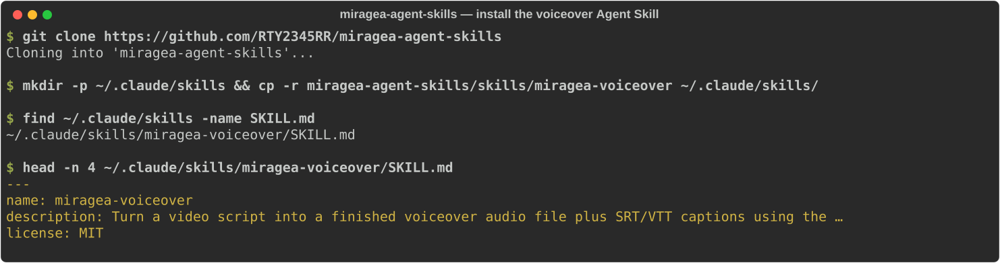
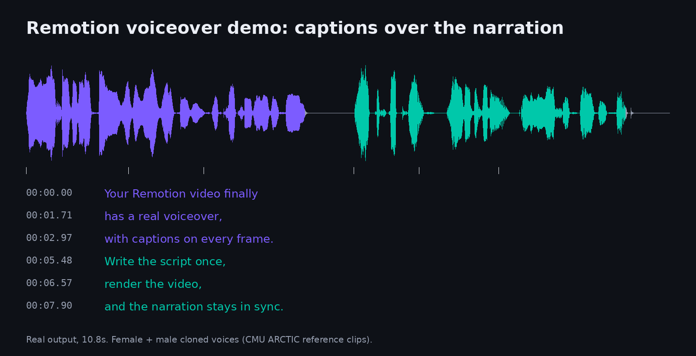
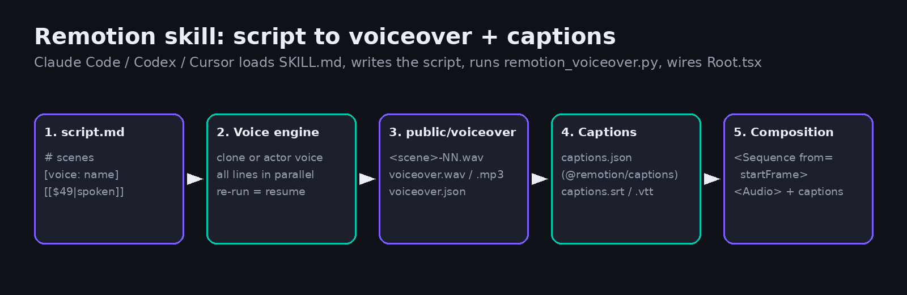
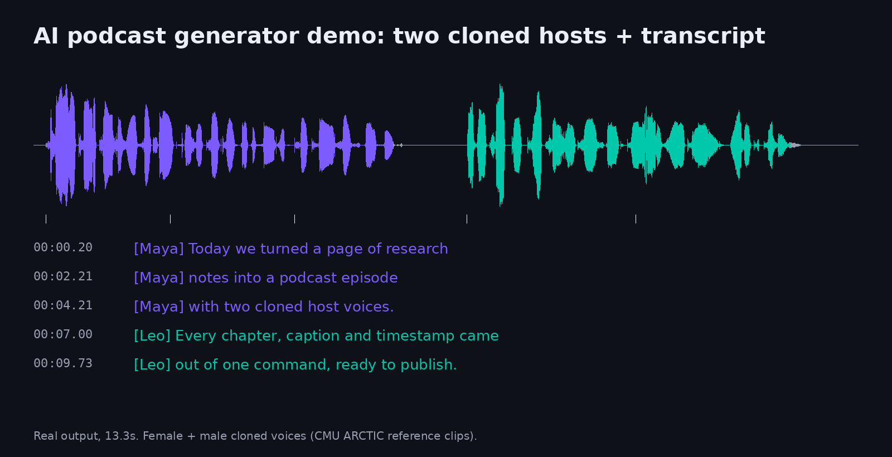
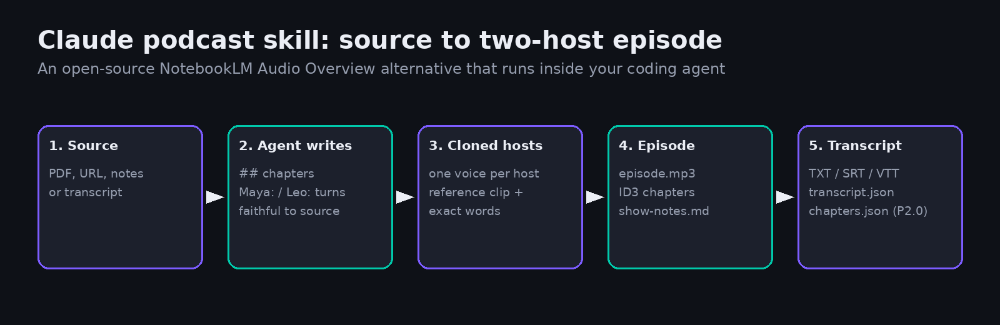
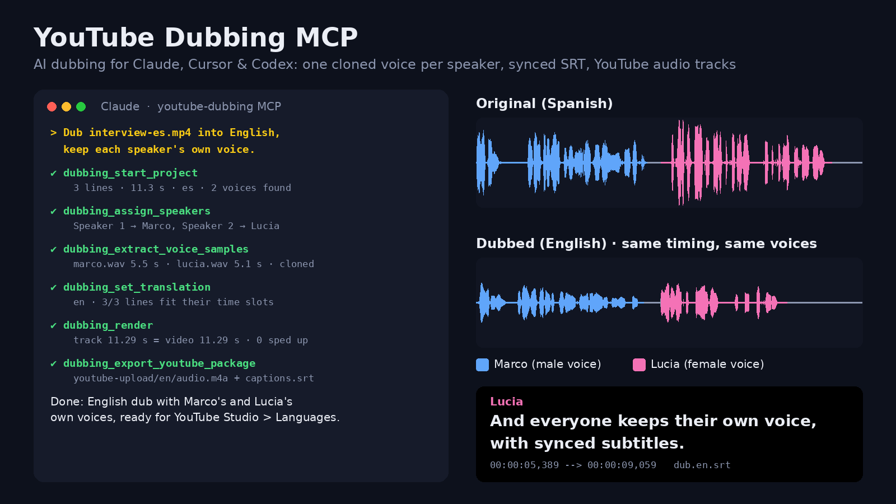
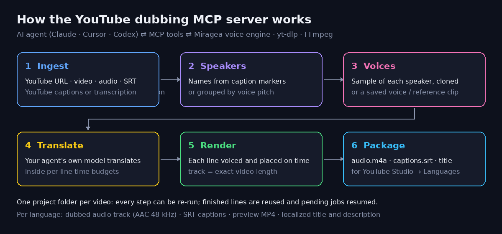
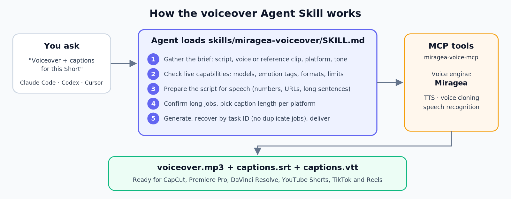

# Claude Code skills for AI voiceover, Remotion, podcasts and YouTube dubbing

[](https://github.com/RTY2345RR/miragea-agent-skills/actions/workflows/tests.yml)
[](LICENSE)
[](https://agentskills.io)
[](https://www.python.org)

**miragea-agent-skills is an open-source collection of Claude Code skills that turn AI coding agents into audio and video producers. Five `SKILL.md` skills create voiceovers with SRT/VTT captions, Remotion narration with `@remotion/captions`, two-host AI podcasts, YouTube Shorts voiceovers and multi-speaker YouTube dubbing. They run in Claude Code, Codex and Cursor, with cloned voices.**

Every skill ships with real output (a male and a female cloned voice) in its `examples/` folder, and the test suite runs against a mocked voice engine in CI. Voices, voice cloning and speech recognition come from the [Miragea](https://miragea.ai) voice engine (`https://miragea.ai/v1`).

```text
You:    Turn notes.pdf into a 6-minute two-host podcast with chapters.
Agent:  (uses the ai-podcast-generator skill)
        → episode/episode.mp3  transcript.srt  transcript.json  chapters.json  show-notes.md
```



## Contents

- [Skills at a glance](#skills-at-a-glance)
- [Quick start](#quick-start)
- [Remotion voiceover skill](#remotion-voiceover-skill)
- [AI podcast generator skill](#ai-podcast-generator-skill)
- [YouTube Shorts voiceover skill](#youtube-shorts-voiceover-skill)
- [YouTube dubbing skill](#youtube-dubbing-skill)
- [AI voiceover and captions skill](#ai-voiceover-and-captions-skill)
- [Install in Claude Code, Codex, Cursor and Claude.ai](#install-in-claude-code-codex-cursor-and-claudeai)
- [Use cases](#use-cases)
- [Comparison](#comparison)
- [FAQ](#faq)
- [Troubleshooting](#troubleshooting)
- [Related projects](#related-projects)
- [Credits and license](#credits-and-license)

## Skills at a glance

| Skill | What it produces | Runs with | Demo |
| --- | --- | --- | --- |
| [`remotion-voiceover`](skills/remotion-voiceover/SKILL.md) | Per-scene voiceover WAV/MP3, `voiceover.json` timeline (`startFrame`, `durationInFrames`), `captions.json` for `@remotion/captions`, SRT/VTT | Bundled Python (stdlib) or `npx` | [voiceover.mp3](skills/remotion-voiceover/examples/voiceover.mp3) |
| [`ai-podcast-generator`](skills/ai-podcast-generator/SKILL.md) | Two-host episode MP3 with ID3 chapters, transcript TXT/SRT/VTT/JSON, Podcasting 2.0 `chapters.json`, show notes | Bundled Python (stdlib) + ffmpeg | [episode.mp3](skills/ai-podcast-generator/examples/episode.mp3) |
| [`youtube-shorts-voiceover`](skills/youtube-shorts-voiceover/SKILL.md) | Shorts narration, short-line SRT + karaoke ASS captions, two-voice dialogue, SRT dubbing, 9:16 mux | Bundled Python + ffmpeg | [shorts-voiceover.mp3](skills/youtube-shorts-voiceover/examples/shorts-voiceover.mp3) |
| [`youtube-dubbing`](skills/youtube-dubbing/SKILL.md) | Dubbed audio track per language, each speaker in a cloned voice, synced SRT, upload package | [youtube-dubbing-mcp](https://github.com/RTY2345RR/youtube-dubbing-mcp) | [dub.en.mp3](skills/youtube-dubbing/examples/dub.en.mp3) |
| [`miragea-voiceover`](skills/miragea-voiceover/SKILL.md) | Script to voiceover MP3/WAV + SRT/VTT captions, subtitles for existing audio or video | [miragea-voice-mcp](https://github.com/RTY2345RR/miragea-voice-mcp) | [workflow](docs/images/voiceover-agent-skill-workflow-diagram.png) |

## Quick start

1. Create a voice-engine API key at [miragea.ai/workspace/api](https://miragea.ai/workspace/api) and export it: `export MIRAGEA_API_KEY=...` (setup help for agents: "Install https://miragea.ai/skills/miragea-audio/install.md").
2. Install the skills in Claude Code:

   ```text
   /plugin marketplace add RTY2345RR/miragea-agent-skills
   /plugin install remotion-voiceover@miragea-agent-skills
   /plugin install ai-podcast-generator@miragea-agent-skills
   /plugin install voiceover-skills@miragea-agent-skills
   ```

3. Ask your agent: "Add a voiceover with captions to my Remotion video" or "Turn this PDF into a two-host podcast".

Prefer plain folders? `git clone https://github.com/RTY2345RR/miragea-agent-skills && cp -r miragea-agent-skills/skills/* ~/.claude/skills/`

## Remotion voiceover skill

[`remotion-voiceover`](skills/remotion-voiceover/SKILL.md) gives a Remotion project a real narrator. The agent writes a `script.md` (one `# Heading` per scene), voices every line with a cloned or stock voice, and wires the audio and word-timed captions into the composition with `<Sequence from={startFrame}>`, `<Audio>` and `createTikTokStyleCaptions()`.



**Demo (real output, 10.8 s, female + male cloned voices):** [voiceover.mp3](skills/remotion-voiceover/examples/voiceover.mp3) · [captions.srt](skills/remotion-voiceover/examples/captions.srt) · [captions.json](skills/remotion-voiceover/examples/captions.json) · [voiceover.json](skills/remotion-voiceover/examples/voiceover.json) · [Narrated.tsx](skills/remotion-voiceover/examples/Narrated.tsx)

> Transcript: "Your Remotion video finally has a real voiceover, with captions on every frame." / "Write the script once, render the video, and the narration stays in sync."

```bash
python skills/remotion-voiceover/scripts/remotion_voiceover.py plan script.md       # dry run, no API calls
python skills/remotion-voiceover/scripts/remotion_voiceover.py generate script.md   # writes public/voiceover/
```

The same job is also available as a Node CLI from [RTY2345RR/remotion-voiceover](https://github.com/RTY2345RR/remotion-voiceover): `npx -y github:RTY2345RR/remotion-voiceover generate script.md`. The bundled Python script needs no install and is the default.



## AI podcast generator skill

[`ai-podcast-generator`](skills/ai-podcast-generator/SKILL.md) is a Claude podcast skill and an open-source NotebookLM Audio Overview alternative. The agent reads a PDF, web page, transcript or notes, writes a faithful two-host conversation in chapters, and the bundled script voices each host and assembles a publish-ready episode.



**Demo (real output, 13.3 s, female host Maya + male host Leo):** [episode.mp3](skills/ai-podcast-generator/examples/episode.mp3) · [transcript.srt](skills/ai-podcast-generator/examples/transcript.srt) · [transcript.txt](skills/ai-podcast-generator/examples/transcript.txt) · [transcript.json](skills/ai-podcast-generator/examples/transcript.json) · [chapters.json](skills/ai-podcast-generator/examples/chapters.json) · [show-notes.md](skills/ai-podcast-generator/examples/show-notes.md) · [episode-script.md](skills/ai-podcast-generator/examples/episode-script.md)

```bash
python skills/ai-podcast-generator/scripts/podcast.py plan episode.md --host "Maya=<clip-url>|Exact words in the clip." --host "Leo=<actor-id>"
python skills/ai-podcast-generator/scripts/podcast.py make episode.md --out episode/ --host "Maya=..." --host "Leo=..."
```



Need RSS feeds or a CLI that ingests PDFs itself? See [podcast-generator-mcp](https://github.com/RTY2345RR/podcast-generator-mcp) and [open-podcast-generator](https://github.com/RTY2345RR/open-podcast-generator).

## YouTube Shorts voiceover skill

[`youtube-shorts-voiceover`](skills/youtube-shorts-voiceover/SKILL.md) turns a Shorts script into narrator audio with big, short-line Shorts captions (SRT + karaoke ASS), voices one or two speakers, dubs a translated SRT into slot-fitted audio, and muxes it onto a vertical 9:16 video with ffmpeg. Captions are balanced so no cue ends on a one-word orphan.

**Demo (real output):** [shorts-voiceover.mp3](skills/youtube-shorts-voiceover/examples/shorts-voiceover.mp3) · [shorts-captions.srt](skills/youtube-shorts-voiceover/examples/shorts-captions.srt)

> Transcript (3 captions): "Octopuses have three hearts." / "Two pump blood to the gills," / "and one keeps the body running."

## YouTube dubbing skill

[`youtube-dubbing`](skills/youtube-dubbing/SKILL.md) dubs a YouTube or local video into another language while each speaker keeps a cloned version of their own voice, with synced SRT captions and a multi-language audio upload package. It drives the [youtube-dubbing-mcp](https://github.com/RTY2345RR/youtube-dubbing-mcp) MCP server.



**Demo (real output, male speaker Marco + female speaker Lucia):** [dub.en.mp3](skills/youtube-dubbing/examples/dub.en.mp3) · [dubbed-interview-en.mp4](skills/youtube-dubbing/examples/dubbed-interview-en.mp4) · [dub.en.srt](skills/youtube-dubbing/examples/dub.en.srt) · [dub.en.speakers.srt](skills/youtube-dubbing/examples/dub.en.speakers.srt)



## AI voiceover and captions skill

[`miragea-voiceover`](skills/miragea-voiceover/SKILL.md) turns a script into a finished voiceover (MP3/WAV) with SRT and WebVTT captions, creates subtitles for existing audio or video, and clones a voice from a reference clip. It prepares the script for speech (numbers, versions, URLs spelled out), tunes caption length per platform (24–32 characters for vertical video, 42 for YouTube) and resumes timed-out jobs by task ID. It drives the [miragea-voice-mcp](https://github.com/RTY2345RR/miragea-voice-mcp) MCP server.



## Install in Claude Code, Codex, Cursor and Claude.ai

| Agent | Skills folder (user / project) | Install |
| --- | --- | --- |
| Claude Code | `~/.claude/skills/` / `.claude/skills/` | `/plugin marketplace add RTY2345RR/miragea-agent-skills`, then `/plugin install <plugin>@miragea-agent-skills` |
| OpenAI Codex | `~/.agents/skills/` / `.agents/skills/` | `cp -r miragea-agent-skills/skills/<skill> ~/.agents/skills/` |
| Cursor | `~/.cursor/skills/` / `.cursor/skills/` | `cp -r miragea-agent-skills/skills/<skill> ~/.cursor/skills/` |
| Claude.ai / Claude Desktop | Settings → Capabilities → Skills | Zip `skills/<skill>` and upload it |

Plugins in the marketplace: `voiceover-skills` (miragea-voiceover), `remotion-voiceover`, `ai-podcast-generator`.

`remotion-voiceover`, `ai-podcast-generator` and `youtube-shorts-voiceover` call the voice engine directly from their bundled scripts and only need `MIRAGEA_API_KEY` in the environment. `miragea-voiceover` and `youtube-dubbing` use an MCP server; add it once:

```bash
claude mcp add miragea-voice -s user -e MIRAGEA_API_KEY=<your-miragea-api-key> -- uvx --from git+https://github.com/RTY2345RR/miragea-voice-mcp miragea-voice-mcp
claude mcp add youtube-dubbing -s user -e MIRAGEA_API_KEY=<your-miragea-api-key> -- uvx --from git+https://github.com/RTY2345RR/youtube-dubbing-mcp youtube-dubbing-mcp
```

For Codex (`~/.codex/config.toml`) and Cursor (`~/.cursor/mcp.json`), print a ready config with `uvx --from git+https://github.com/RTY2345RR/miragea-voice-mcp miragea-voice-mcp --print-config <client>`.

## Use cases

### Add a voiceover to a Remotion video
Ask "add a narrator and TikTok-style captions to my Remotion composition". The `remotion-voiceover` skill writes `public/voiceover/` and the agent places each scene with `<Sequence from={startFrame}>`.

### Generate Remotion captions with @remotion/captions
`captions.json` is a `Caption[]` array (`text`, `startMs`, `endMs`, `timestampMs`, `confidence`) that `createTikTokStyleCaptions()` reads directly.

### Turn a PDF into a podcast
Give the agent a paper or report; `ai-podcast-generator` writes the two-host script from it, voices it and returns an MP3 with chapters and a transcript.

### Make a two-person AI podcast with your own voices
Pass one reference clip per host (plus the exact words in each clip) to get a podcast in cloned voices.

### Create a YouTube Shorts voiceover with captions
`youtube-shorts-voiceover` writes narration plus short Shorts captions and can mux them onto a 9:16 video.

### Dub a YouTube video into English with each speaker's voice
`youtube-dubbing` keeps every speaker's own cloned voice in the target language and outputs synced SRT captions.

### Generate SRT and VTT subtitles for a video
`miragea-voiceover` transcribes existing audio or video and writes `.srt` and `.vtt` files.

## Comparison

| | miragea-agent-skills | Google NotebookLM Audio Overview | Podcastfy | Remotion + hand-wired TTS |
| --- | --- | --- | --- | --- |
| Runs inside Claude Code / Codex / Cursor | Yes (`SKILL.md`) | No (web app) | No (Python library / CLI) | Manual |
| Open source | Yes (MIT) | No | Yes (Apache-2.0) | Remotion is source-available |
| Edit the script before voicing | Yes (`script.md` / `episode.md`) | Not documented | Yes | Yes |
| Voice cloning from a reference clip | Yes | No | Depends on TTS provider | Depends on TTS provider |
| Speaker-labelled transcript SRT/VTT | Yes | Not documented | Not documented | Manual |
| Podcast chapters (ID3 + `chapters.json`) | Yes | Not documented | Not documented | n/a |
| Remotion `voiceover.json` + `@remotion/captions` output | Yes | No | No | Manual |
| YouTube dubbing per speaker | Yes (via youtube-dubbing-mcp) | No | No | No |

## FAQ

### What are Claude Code skills?
Claude Code skills are folders with a `SKILL.md` file (name, description, instructions, optional scripts) that the agent loads only when a request matches. The same open format works in Claude.ai, OpenAI Codex and Cursor, so these skills install in all of them.

### How do I install skills in Claude Code?
Run `/plugin marketplace add RTY2345RR/miragea-agent-skills` and then `/plugin install <plugin>@miragea-agent-skills`. You can also copy a folder from `skills/` into `~/.claude/skills/` (personal) or `.claude/skills/` (project).

### Is there a Remotion skill for Claude Code?
Yes. `remotion-voiceover` adds AI voiceover and captions to a Remotion project: per-scene audio, a frame-accurate `voiceover.json` timeline and `@remotion/captions` captions. Ask Claude Code to "add a voiceover to my Remotion video".

### How do I add captions to a Remotion video?
Install `@remotion/captions` (`npx remotion add @remotion/captions`), run the skill to create `public/voiceover/captions.json`, and render it with `createTikTokStyleCaptions()`. See [Narrated.tsx](skills/remotion-voiceover/examples/Narrated.tsx) for a working composition.

### Is there an open-source NotebookLM alternative?
Yes. `ai-podcast-generator` turns a PDF, URL or notes into a two-host podcast like NotebookLM Audio Overview, but runs inside your coding agent, lets you edit the script, and uses voices you choose or clone.

### How do I turn a PDF into a podcast with AI?
Install `ai-podcast-generator`, then ask your agent "turn report.pdf into a 6-minute podcast with two hosts". It writes `episode.md`, runs `podcast.py make`, and returns `episode.mp3` with chapters, transcript and show notes.

### Can I use my own voice?
Yes. Every skill accepts a public reference clip URL plus the exact words spoken in it, and clones that voice. Only clone voices you have the right to use.

### Which voice engine do the skills use?
They use the [Miragea](https://miragea.ai) voice engine (`https://miragea.ai/v1`) for text-to-speech, voice cloning and speech recognition. There is no hidden fallback to another TTS service.

### Do the skills work in Codex and Cursor?
Yes. Copy the skill folder into `~/.agents/skills/` (Codex) or `~/.cursor/skills/` (Cursor). The bundled Python scripts only need Python 3.9+ and `MIRAGEA_API_KEY`.

### Is my API key safe?
The key is read from the `MIRAGEA_API_KEY` environment variable or your MCP config `env` block. The skills tell the agent never to ask for it in chat and never to print it.

## Troubleshooting

| Problem | Fix |
| --- | --- |
| `MIRAGEA_API_KEY is not set` | Export the key in the shell that runs your agent, or add it to the MCP `env` block. Agents can follow "Install https://miragea.ai/skills/miragea-audio/install.md". |
| A line says the task is still running | Cloned lines can take a couple of minutes. Re-run the same command: identical requests re-attach to the same job and finished lines are reused. |
| Voice cloning fails to fetch the clip | The reference clip URL must be directly downloadable (a plain `.wav`/`.mp3`), not a Hugging Face resolve link or a page that needs a login. |
| Invalid emotion tag | Run `python scripts/<script>.py check` to list the only valid emotion tags and models. |
| No `episode.mp3`, only WAV | Install ffmpeg; MP3 output with embedded chapters needs it. |
| Remotion cannot find the audio | Output goes to `public/voiceover/`; load it with `staticFile("voiceover/voiceover.wav")`, or pass `--out` to match your project. |
| `npx github:RTY2345RR/remotion-voiceover` fails | Use the bundled Python script, which needs no install: `python scripts/remotion_voiceover.py generate script.md`. |
| `miragea_*` or `dubbing_*` tools are missing | Add the MCP server with the `claude mcp add` commands above and restart the agent. |

## Related projects

- [miragea-voice-mcp](https://github.com/RTY2345RR/miragea-voice-mcp): text-to-speech MCP server with voice cloning and SRT/VTT captions (PyPI: `tts-mcp-server`).
- [youtube-dubbing-mcp](https://github.com/RTY2345RR/youtube-dubbing-mcp): YouTube dubbing MCP server with per-speaker voice cloning.
- [remotion-voiceover](https://github.com/RTY2345RR/remotion-voiceover): Remotion voiceover and captions Node CLI.
- [podcast-generator-mcp](https://github.com/RTY2345RR/podcast-generator-mcp) and [open-podcast-generator](https://github.com/RTY2345RR/open-podcast-generator): AI podcast generator MCP server and CLI.
- Agent Skills spec: [agentskills.io](https://agentskills.io) · [Anthropic docs](https://docs.anthropic.com/en/docs/agents-and-tools/agent-skills). Plain-text summary for AI assistants: [llms.txt](llms.txt).

## Credits and license

Demo voices were cloned from the [CMU ARCTIC](http://festvox.org/cmu_arctic/) speech databases (speakers SLT, female, and BDL, male), Copyright (c) 2003 Carnegie Mellon University, used under its permissive licence. See [CREDITS.md](CREDITS.md) for the full notice.

Code and docs: [MIT](LICENSE). Use cloned voices only with the speaker's consent. To cite this project, use [CITATION.cff](CITATION.cff).
